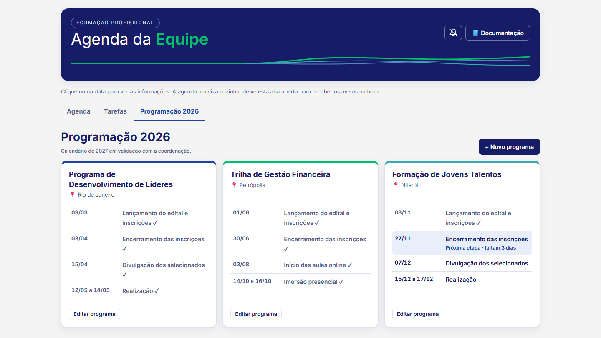

# Agenda da Equipe – Formação Profissional

Página web de agendamento e acompanhamento da equipe de Formação Profissional de uma organização. Ela reúne num só lugar as reuniões, a programação anual dos programas e as tarefas de cada colaborador.

- **Página em uso:** publicada no claude.ai, com acesso restrito à equipe (o endereço não é divulgado neste repositório)
- **Documentação técnica completa:** [docs/DOCUMENTACAO_TECNICA.md](docs/DOCUMENTACAO_TECNICA.md)
- **Versão do código neste repositório:** 52, de 24/11/2026

## O que a agenda faz

| Aba | Para que serve |
| --- | --- |
| **Agenda** | Calendário do mês. Clique numa data para ver e incluir reuniões, etapas de programas e tarefas do dia. Também tem relatórios do dia, do mês ou do ano (CSV/HTML) e envio pelo WhatsApp |
| **Tarefas** | Um cartão por colaborador, com tarefas pendentes, concluídas e atrasadas, mais um Backlog de tarefas disponíveis para quem quiser pegar. Gera um relatório mensal em PDF |
| **Programação** | Linha do tempo anual de cada programa (edital, inscrições, divulgação, aulas, imersão, realização) |

Ela também avisa quando há novidades desde a última visita e pode mostrar alertas no navegador.

## Como fica

> As imagens usam **dados fictícios**: reuniões, programas, tarefas e nomes foram inventados para esta demonstração.

**Agenda:** calendário do mês, com o dia selecionado à direita e os próximos compromissos abaixo.


**Tarefas:** um cartão por colaborador e o Backlog. Ao clicar num nome, aparecem as demandas da pessoa.


**Programação:** as etapas de cada programa no ano, com destaque para a próxima.



## Como funciona

```
index.html  ──lê/grava──►  Banco compartilhado do artefato (claude.ai)
                                 coleções: avisos · tarefas · notas
```

- **Um único arquivo:** todo o código (HTML, CSS e JavaScript) está em [index.html](index.html).
- **Os dados não ficam no arquivo.** Eles ficam no banco compartilhado do artefato, dentro do claude.ai, e são atualizados em tempo real para todos.
- **A página depende do claude.ai.** Ela usa recursos da plataforma (banco `db` e `downloads`). Aberta direto do disco ou de outro site, carrega o layout, mas não os dados.

## Estrutura do projeto

```
artefato_agendamento_equipe/
├── index.html                    Código completo da página (cópia da versão publicada)
├── README.md                     Este arquivo
├── .gitignore                    Arquivos que não devem ir para o GitHub
└── docs/
    ├── DOCUMENTACAO_TECNICA.md   Funcionalidades, dados, permissões, histórico e manutenção
    └── imagens/                  Prints das abas, com dados fictícios
```

## Como fazer alterações

O fluxo oficial continua sendo o claude.ai:

1. Peça a alteração ao Claude usando a conta do setor e informe o link interno da agenda.
2. O Claude publica uma nova versão no mesmo endereço. Os dados não se perdem.
3. Atualize este repositório: substitua o [index.html](index.html) pela versão nova e registre a mudança no histórico da [documentação técnica](docs/DOCUMENTACAO_TECNICA.md#histórico-de-alterações).

Este repositório serve como **cópia de segurança e histórico do código**. Ele não substitui a página publicada.

## Avisos importantes

- **Nomes fictícios:** nesta cópia pública, os nomes da equipe foram trocados por cargos genéricos: Coordenador e Colaborador 1 a 5. A versão no claude.ai usa os nomes reais. Ao atualizar o `index.html` a partir do claude.ai, faça a troca de novo antes do commit.
- **Não registre dados sensíveis na agenda.** Tudo nela fica visível para quem tem acesso.
- **Cópia dos dados:** os registros (reuniões, tarefas) não estão neste repositório. Faça backup mensal pelo relatório em CSV e salve no SharePoint.
- **Fonte dos títulos:** a versão publicada no claude.ai usa a fonte **Intro** (© Fontfabric), que é comercial e faz parte da identidade visual da organização. Como este repositório é público, a Intro foi retirada desta cópia e os títulos usam a **Inter** (fonte livre, do Google Fonts). Ao atualizar o `index.html` com uma versão nova do claude.ai, remova de novo os blocos `@font-face` da Intro antes do commit.

## Responsáveis

Suany Salgado – Analista de IA.
