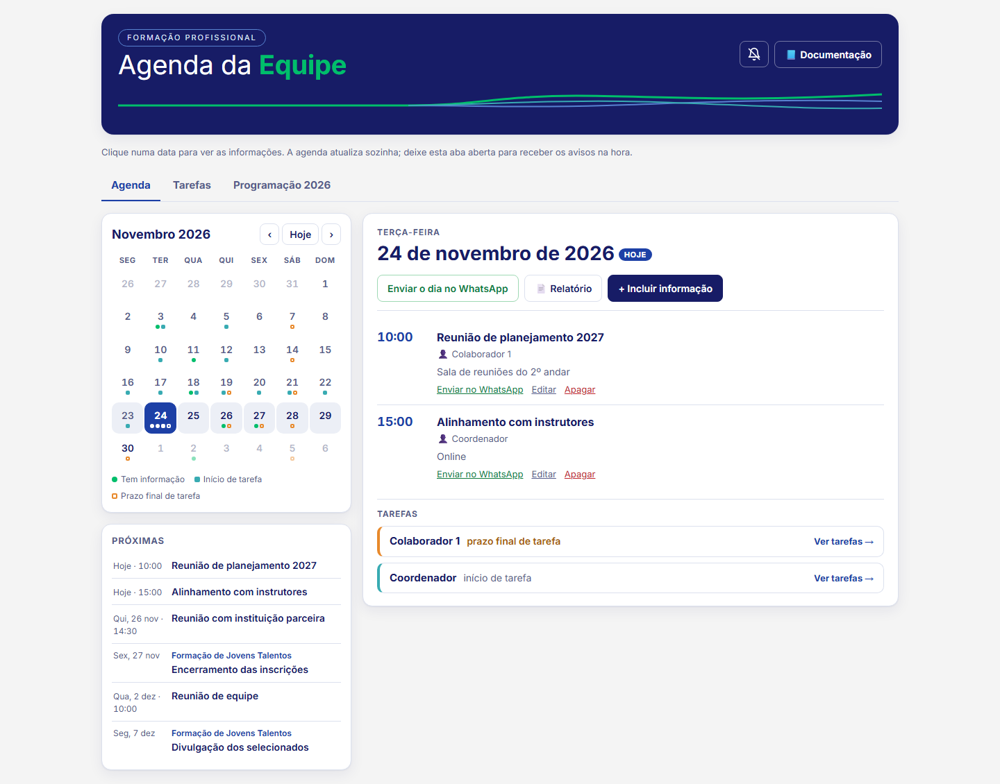
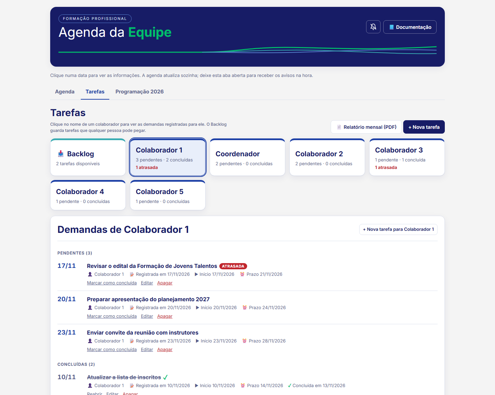

# Agenda da Equipe 

Página web de agendamento e acompanhamento da equipe de Formação Profissional de uma organização. Ela reúne num só lugar as reuniões, a programação anual dos programas e as tarefas de cada colaborador.

- **Página em uso:** publicada no claude.ai, com acesso restrito à equipe (o endereço não é divulgado neste repositório)
- **Documentação técnica completa:** [docs/DOCUMENTACAO_TECNICA.md](docs/DOCUMENTACAO_TECNICA.md)
- **Versão do código neste repositório:** 52, de 24/11/2026

## O que a agenda faz

| Aba | Para que serve |
| --- | --- |
| **Agenda** | Calendário do mês. Clique numa data para ver e incluir reuniões, etapas de programas e tarefas do dia. Também tem relatórios do dia, do mês ou do ano (CSV/HTML) e envio pelo WhatsApp |
| **Tarefas** | Um cartão por colaborador, com tarefas pendentes, concluídas e atrasadas, mais um Backlog de tarefas disponíveis para quem quiser pegar. Gera um relatório mensal em PDF |
| **Programação** | Linha do tempo anual de cada programa (edital, inscrições, divulgação, aulas, imersão, realização) |

Ela também avisa quando há novidades desde a última visita e pode mostrar alertas no navegador.

## Como fica

> As imagens usam **dados fictícios**: reuniões, programas, tarefas e nomes foram inventados para esta demonstração.

**Agenda:** calendário do mês, com o dia selecionado à direita e os próximos compromissos abaixo.



**Tarefas:** um cartão por colaborador e o Backlog. Ao clicar num nome, aparecem as demandas da pessoa.



**Programação:** as etapas de cada programa no ano, com destaque para a próxima.


## Como funciona

```
index.html  ──lê/grava──►  Banco compartilhado do artefato (claude.ai)
                                 coleções: avisos · tarefas · notas
```

- **Um único arquivo:** todo o código (HTML, CSS e JavaScript) está em [index.html](index.html).
- **Os dados não ficam no arquivo.** Eles ficam no banco compartilhado do artefato, dentro do claude.ai, e são atualizados em tempo real para todos.
- **A página depende do claude.ai.** Ela usa recursos da plataforma (banco `db` e `downloads`). Aberta direto do disco ou de outro site, carrega o layout, mas não os dados.

## Como usar esta agenda no seu claude.ai

Sim, qualquer pessoa pode criar a própria agenda a partir deste repositório. Você não precisa saber programar: o Claude faz a parte técnica.

**Antes de começar, saiba que:**

- A sua agenda será **nova e vazia**. As reuniões e tarefas da nossa equipe não estão aqui e não vão junto.
- Ela **não fica ligada** à nossa agenda. O que você fizer na sua não muda a nossa, e vice-versa.
- Você precisa de uma conta no [claude.ai](https://claude.ai) que permita **criar e compartilhar artefatos** (as páginas que o Claude publica). Para a equipe toda usar, o ideal é uma conta de organização (planos Team ou Enterprise).

### Passo a passo

**1. Baixe o arquivo da página**

Aqui no GitHub, clique em [index.html](index.html) e depois no botão **Download raw file** (ícone de seta para baixo, no canto direito acima do código). O arquivo vai para a sua pasta Downloads.

**2. Abra uma conversa nova no claude.ai**

Entre no claude.ai e clique em **Nova conversa**. Anexe o `index.html` com o clipe (📎) ou arrastando o arquivo para a caixa de mensagem.

**3. Copie, ajuste e envie a mensagem abaixo**

Troque o que está entre colchetes pelos nomes da sua equipe. Se tiver menos ou mais pessoas, é só listar quem tiver.

```
Publique este arquivo index.html como um artefato, sem mudar o layout nem
as funções. A página usa o banco compartilhado do artefato (coleções
avisos, tarefas e notas) e a função de downloads. Ative as duas.

Antes de publicar, troque os nomes da equipe (nas listas COLABS e TCOLABS
e nas opções do formulário):
- Coordenador → [nome da coordenação]
- Colaborador 1 → [nome]
- Colaborador 2 → [nome]
- Colaborador 3 → [nome]
- Colaborador 4 → [nome]
- Colaborador 5 → [nome]

Troque também "Formação Profissional" pelo nome da minha área: [nome da área].
```

**4. Abra a agenda e faça um teste**

O Claude responde com o link da página publicada. Abra o link, inclua uma reunião de teste e confira se ela aparece no calendário. Depois apague o teste.

**5. Compartilhe com a equipe**

Na página do artefato, use o botão **Compartilhar** e escolha quem pode **ver** e quem pode **editar**. Só dê permissão de edição a quem vai incluir ou alterar compromissos: é essa permissão que protege os dados, não a página.

**6. Guarde o link**

Salve o endereço da agenda num lugar que a equipe use (favoritos, canal da equipe). Para mudar algo depois, abra uma conversa no claude.ai, cole o link e peça a alteração. O Claude publica a nova versão no mesmo endereço, sem perder os dados.

### Se algo não funcionar

| O que acontece | O que fazer |
| --- | --- |
| A página abre, mas não salva nada | O banco compartilhado não foi ativado. Peça ao Claude: "ative o banco compartilhado (db) neste artefato". Se continuar, o recurso pode não estar liberado no seu plano |
| O botão de relatório não baixa o arquivo | Peça ao Claude: "ative a função de downloads neste artefato" |
| Apareceu "Colaborador 1" em vez do nome da pessoa | Peça ao Claude: "troque o nome Colaborador 1 por [nome] em toda a página" |
| Abri o `index.html` direto no computador e está vazio | É o esperado. A agenda só guarda dados quando está publicada no claude.ai |

> **Lembrete:** tudo o que for registrado na agenda fica visível para quem tem acesso a ela. Não inclua dados pessoais ou sensíveis.

## Estrutura do projeto

```
artefato_agendamento_equipe/
├── index.html                    Código completo da página (cópia da versão publicada)
├── README.md                     Este arquivo
├── .gitignore                    Arquivos que não devem ir para o GitHub
└── docs/
    ├── DOCUMENTACAO_TECNICA.md   Funcionalidades, dados, permissões, histórico e manutenção
    └── imagens/                  Prints das abas, com dados fictícios
```

## Como fazer alterações (equipe responsável por esta agenda)

Para a nossa agenda, o fluxo oficial continua sendo o claude.ai:

1. Peça a alteração ao Claude usando a conta do setor e informe o link interno da agenda.
2. O Claude publica uma nova versão no mesmo endereço. Os dados não se perdem.
3. Atualize este repositório: substitua o [index.html](index.html) pela versão nova e registre a mudança no histórico da [documentação técnica](docs/DOCUMENTACAO_TECNICA.md#histórico-de-alterações).

Este repositório serve como **cópia de segurança e histórico do código**. Ele não substitui a página publicada.

## Avisos importantes

- **Nomes fictícios:** nesta cópia pública, os nomes da equipe foram trocados por cargos genéricos: Coordenador e Colaborador 1 a 5. A versão no claude.ai usa os nomes reais. Ao atualizar o `index.html` a partir do claude.ai, faça a troca de novo antes do commit.
- **Não registre dados sensíveis na agenda.** Tudo nela fica visível para quem tem acesso.
- **Cópia dos dados:** os registros (reuniões, tarefas) não estão neste repositório. Faça backup mensal pelo relatório em CSV e salve na pasta compartilhada da equipe.
- **Fonte dos títulos:** a versão publicada no claude.ai usa uma fonte comercial da identidade visual. Como este repositório é público, ela foi retirada desta cópia e os títulos usam a **Inter** (fonte livre, do Google Fonts). Ao atualizar o `index.html` com uma versão nova do claude.ai, remova de novo os blocos `@font-face` dessa fonte antes do commit.

## Responsáveis

Suany Salgado – Analista de IA.
